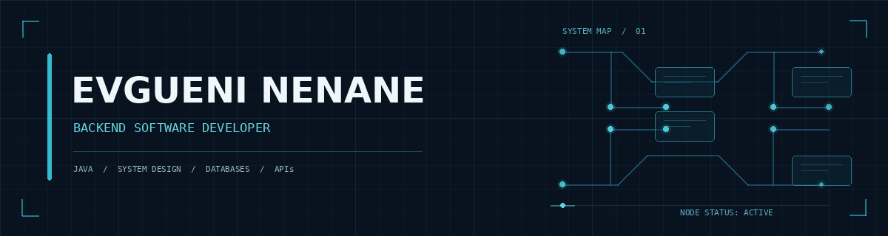
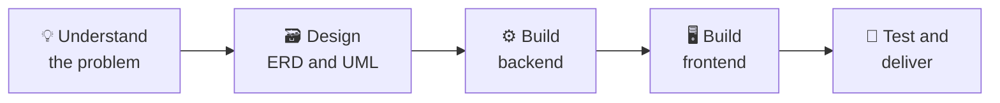

  

  

  
  
  
  

---

## 👨‍💻 About me

I'm a software developer who leans toward the **backend**: databases, business logic and APIs.
I like to plan a system on paper first (ERD, UML, roadmap) and only then write the code, because a clear design saves hours of rework.

- 🔭 Building: **Roulette_Study**, an AI-assisted study system
- 🧱 Strongest at: Java, Spring Boot, PHP and relational databases
- 🖥️ Daily driver: **Fedora Linux**
- 🤝 Looking for: small freelance projects for businesses, schools and organizations
- 📫 Reach me at: **evgueninenane73@gmail.com**

---

## 🧰 Tech stack

<table align="center">
  <tr>
    <td align="center" width="170"><b>Backend &amp; APIs</b></td>
    <td align="left">
      &nbsp;&nbsp;&nbsp;&nbsp;
      &nbsp;&nbsp;&nbsp;&nbsp;
      &nbsp;&nbsp;&nbsp;&nbsp;
      
    </td>
  </tr>
  <tr>
    <td align="center"><b>Frontend</b></td>
    <td align="left">
      &nbsp;&nbsp;&nbsp;&nbsp;
      &nbsp;&nbsp;&nbsp;&nbsp;
      
    </td>
  </tr>
  <tr>
    <td align="center"><b>Databases</b></td>
    <td align="left">
      &nbsp;&nbsp;&nbsp;&nbsp;
      &nbsp;&nbsp;&nbsp;&nbsp;
      
    </td>
  </tr>
  <tr>
    <td align="center"><b>Tools</b></td>
    <td align="left">
      &nbsp;&nbsp;&nbsp;&nbsp;
      &nbsp;&nbsp;&nbsp;&nbsp;
      &nbsp;&nbsp;&nbsp;&nbsp;
      &nbsp;&nbsp;&nbsp;&nbsp;
      &nbsp;&nbsp;&nbsp;&nbsp;
      
    </td>
  </tr>
  <tr>
    <td align="center"><b>Design</b></td>
    <td align="left">
      
    </td>
  </tr>
</table>

  
  
  
  
  
  

---

## ⚙️ How I build a system

---

## 📌 Featured projects

| Project | What it is | Stack |
|---|---|---|
| [**Roulette_Study**](https://github.com/Evgueni-Nenane/Roulette_Study) | Spin a roulette, get a topic and a time limit, then answer inside the system. An AI reviews your answer and gives a score. | `ADD STACK` |
| [**MusicStreamApp**](https://github.com/Evgueni-Nenane/MusicStreamApp) | Music streaming app built with three colleagues as a school project. | PHP |
| [**MusicStreamApp_Java**](https://github.com/Evgueni-Nenane/MusicStreamApp_Java) | Java system built as a school project. | Java |
| [**Portfolio**](https://github.com/Evgueni-Nenane/Portfolio) | My personal portfolio website. | HTML · CSS |

---

## 💼 How I can help

<b>Click to see my services</b>

 

- 🌐 Websites and web systems for small businesses
- 🔌 Backend development and REST / GraphQL APIs
- 🗃️ Database modelling and system design (ERD and UML)
- 🖥️ Turning web apps into desktop apps with Electron
- 🛠️ Fixing bugs and extending existing PHP or Java systems

---

## 📊 GitHub stats

<!-- If the two cards below or the activity graph show as blank or as text, the free service is down: delete that block -->

  
  

  

  

  <picture>
    <source media="(prefers-color-scheme: dark)" srcset="https://raw.githubusercontent.com/Evgueni-Nenane/Evgueni-Nenane/output/github-snake-dark.svg" />
    
  </picture>

---

## 🤝 Let's work together

Have a project in mind, or need a system built for your business?
Send me a message and tell me what you need.

  
  

  

  

